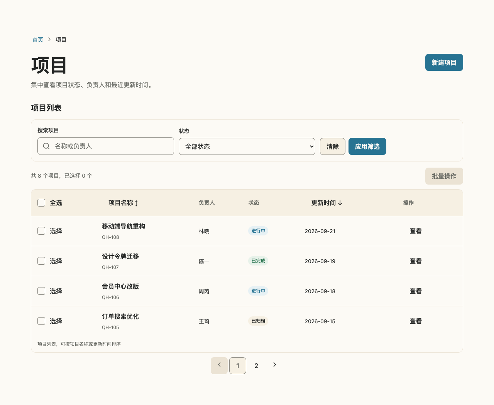
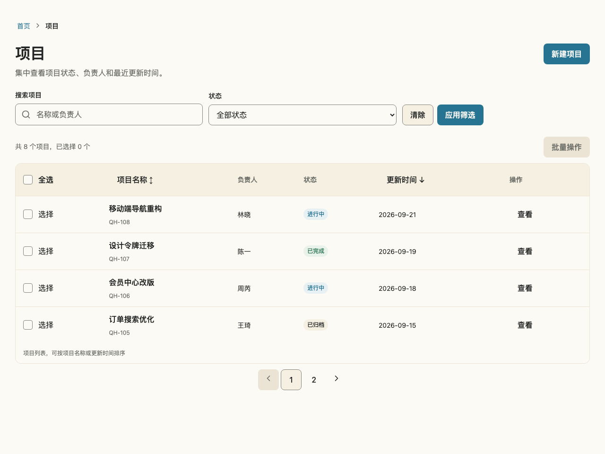
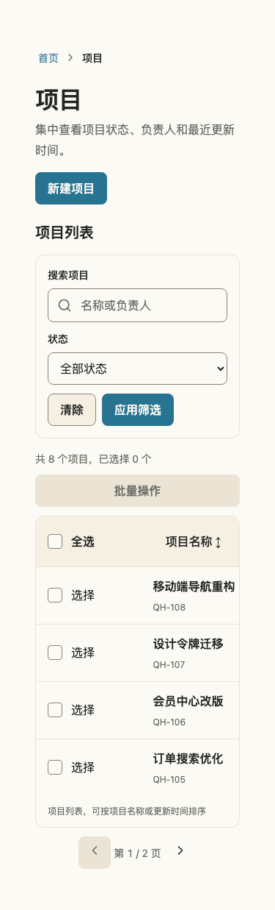
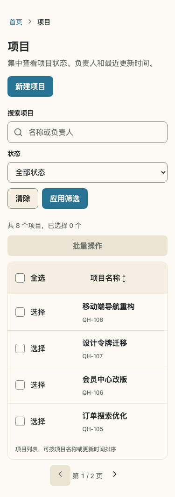

# QH 现代扁平化视觉审查与升级建议

日期：2026-11-06。审查基线：`27c398ed01ff2295c0f22f5ae0636961e30aee3d`，线上 `@qhkg/react@0.7.0`。

状态：本报告保留 0.7.0 基线的设计审查与视觉草案。已按确认方向完成源码改造；实现规则与迁移见[视觉规范](visual-style-guidelines.md)，发布版本以包 CHANGELOG 为准。用户已选定方向：**保留暖纸色与蓝色，做现代扁平化**。

## 1. 审查结论

当前库的基础架构和品牌配色可以继续使用。默认 Card 已经没有阴影，Button 也采用实色平面表现；优先改进页面排版、容器组合和操作层级，会比统一改色或削减所有阴影更有效。

建议采用“温暖、简洁、以任务为中心”的视觉方向：Paper 作为主要画布，Warm 少量承载分组与辅助信息，Blue Dark 配 Paper 表达主要操作。用文字层级、对齐、间距和必要分隔线组织页面，减少每个区域各自包框的做法。

这是结合源码与页面观察的设计判断。以下草案用于比较视觉方向，不代表已经通过用户研究验证任务效率提升。

## 2. 与成熟开源设计系统的对比

下表中“官方依据”是资料明确表达的原则；“QH 应用建议”是本次审查的推导，不是对方系统的强制规范。

| 参考系统      | 官方依据                                                                                                                                                                     | QH 应用建议                                                                                                |
| ------------- | ---------------------------------------------------------------------------------------------------------------------------------------------------------------------------- | ---------------------------------------------------------------------------------------------------------- |
| Radix Themes  | 组件变体用来表达视觉层级与相对重要性，并在主题中保持一致。[Theme overview](https://www.radix-ui.com/themes/docs/theme/overview)                                              | 明确主要、次要、低强调操作的视觉强度，尤其避免 ghost 在 hover 时突然拥有较重的边框。                       |
| shadcn/ui     | 背景与前景成对定义，分别提供页面、卡片、浮层、边框、输入框与焦点等语义角色。[Theming](https://ui.shadcn.com/docs/theming)                                                    | 学习角色化 Token，不照搬其默认中性配色；继续使用 QH 暖纸色、蓝色与现有 npm 核心包。                        |
| GitHub Primer | 区分背景、边框、文本角色，以及控件 rest、hover、active 状态；基础色值经功能 Token 使用。[Color usage](https://primer.style/product/getting-started/foundations/color-usage/) | 继续区分装饰边框与控件边框，把低强调交互状态纳入统一语义，避免各组件借用文字色临时拼状态。                 |
| Fluent 2      | 排版层级服务内容组织；Web 字阶区分正文、24/28/32px 标题和更大的展示文字。[Typography](https://fluent2.microsoft.design/typography)                                           | 区分工具页面标题与展示型标题，业务页面优先使用更克制的字号；不把其 14px 正文默认值直接套给 QH 手机输入框。 |
| Fluent 2      | 阴影与高度传达层级和焦点，不同高度对应不同场景。[Elevation](https://fluent2.microsoft.design/elevation)                                                                      | 普通页面区域保持平面，Menu、Popover、Dialog 等浮层保留必要的空间提示。                                     |

这些资料支持建立一致的层级规则；它们并不能证明某一种外观符合所有人的审美。QH 的暖纸色与蓝色是本次已确认的品牌选择。

## 3. 当前实现中的具体问题

### P1：工具页面标题沿用展示型尺寸

[PageHeader](../registry/blocks/page-header/page-header.tsx) 使用 `<Heading level={1}>`，对应 [Heading](../packages/react/src/components/heading/Heading.types.ts) 默认 `xl`。项目列表在 1280px 视口中实际显示为 48px，在 375px 中为 32px。标题与辅助信息占据的空间偏多，弱化了筛选、数据和任务操作。

建议工具页面使用已有的 `<Heading level={1} size="lg">`，当前 Token 在上述视口分别得到 32px、24px。保留语义 h1，也保留展示页选择 xl 的能力。无需修改所有 Heading 的全局默认值。

[Text](../packages/react/src/components/text/Text.module.css) 的各字号统一使用阅读正文行高。建议进一步区分阅读内容与 UI 辅助文案：长文章保留舒展节奏，页面描述、统计、短标签使用更紧凑的 UI 节奏。**当前 Text 没有行高或排版角色属性**；若扩展，需先评审有限枚举及兼容默认值，不能在应用中长期覆盖内部样式。

### P1：页面区域各自包框，缺少整体组合规则

[FilterBar](../registry/blocks/filter-bar/filter-bar.tsx) 和 [Toolbar](../registry/blocks/toolbar/toolbar.tsx) 都默认带外框、圆角、底色和内边距；[DataTable](../registry/blocks/data-table/data-table.tsx) 再组合独立表格边界。当这些模式进入完整页面时，控件、筛选容器、数据容器的多重边界会分散注意力。

建议明确独立区块与嵌入页面两种组合场景：嵌入数据页面的筛选区通过间距与对齐分组，保留一处主要数据边界及必要行分隔；独立区块可以继续使用外框。先在 Registry 组合层解决，不把所有容器变成 Card，也不为每种业务布局新增核心组件。

如确需暴露组合选项，评审 FilterBar/Toolbar 的有限视觉变体，保留独立使用的兼容路径。**当前它们没有此类属性；Card 也只有 outlined、filled、elevated，没有 plain 变体。**

### P1：完整页面示例叠加展示环境留白

[Storybook 装饰器](../apps/storybook/.storybook/preview.tsx) 包裹 `.qh-story-canvas`，其 [样式](../apps/storybook/.storybook/preview.css) 自带页面 gutter；[PageContainer](../packages/react/src/components/page-container/PageContainer.module.css) 又带同一 gutter。当前默认 Storybook padded 布局另有 16px 外边距。

因此项目列表 h1 的实际左侧位置为桌面 80px、手机 48px，而非单层 PageContainer 的 32px、16px。这是完整页面 Story 的展示问题，不能推断使用方业务页面都存在同样的问题。

建议完整页面 Story 使用 `layout: "fullscreen"`，并通过明确的页面级展示配置关闭 canvas padding；孤立组件 Story 保留展示留白。完整页面只由 PageContainer 管理 gutter，不全局取消所有 Story 的 padding。

### P2：低强调按钮的交互状态偏重

[Button CSS](../packages/react/src/components/button/Button.module.css) 中 secondary 和 ghost 共用 hover 规则，后者会出现 Warm 背景和 `text-muted` 色边框；这使行内“查看”等辅助动作在 hover 时增加较强的框感。

建议 ghost 通过轻量背景变化表达 hover/pressed，保持透明边框；secondary 保留清晰控件边界；primary 保持 Blue Dark 与 Paper。键盘焦点继续使用独立 focus-visible 反馈，disabled、loading 不受此降噪影响。此项尚未包含在本次截图草案中，需要单独制作状态矩阵。

### P2：组件级规则已有，页面级视觉语言还需补齐

[ProjectListPage](../registry/blocks/project-list-page/project-list-page.tsx) 已有“项目”h1，又显示“项目列表”h2。对当前单列表页面，后者提供的额外信息较少。建议弱化或改为视觉隐藏的分区标题，保留可访问名称；多分区页面仍应保留可见标题。

目前 canvas 与 surface 使用同一 Paper，surface-subtle 使用 Warm。这本身可以成立，但如果页面处处通过外框区分区域，就会显得模板化。建议先建立标题、说明、筛选、结果、分页的共同排版规范，再决定哪些区块需要 Warm 填充。

## 4. 建议的视觉规则

| 维度     | 升级方向                                                                    | 保留的约束                              |
| -------- | --------------------------------------------------------------------------- | --------------------------------------- |
| 色彩     | Paper 主画布，Warm 少量分组，Blue Dark 集中表达主要动作；状态使用既有语义色 | 仅使用 QH 语义颜色或文档化组件 Token    |
| 标题     | 工具页面 h1 手机 24px、桌面约 28–32px；展示内容单独选择更大字阶             | h1–h6 语义与视觉尺寸分离                |
| 辅助文字 | UI 文案使用更紧凑的行高，正文阅读保留舒展行高                               | 手机表单输入字号不少于 16px             |
| 容器     | 优先间距、对齐、分隔线；仅明确独立的内容单元使用卡片                        | 控件 8px、卡片 12px 圆角；4px 间距尺度  |
| 边界     | 降低装饰性包框数量；表格保留清晰的数据组织                                  | 控件可识别边界、焦点与错误状态保持清晰  |
| 操作     | 每个任务区域有明确主次，辅助动作使用低强调表现                              | 必要操作始终可发现；不依赖 hover 才出现 |
| 阴影     | 页面内容平面化，浮层按任务关系保留阴影                                      | 不全局清除所有 elevation                |
| 密度     | 先调标题、段落与分组，不靠缩小控件制造紧凑感                                | 默认控件 44px；手机优先；表格局部滚动   |

扁平化不能以降低控件可识别性为代价。对于识别组件和状态所必需的视觉信息，WCAG 1.4.11 要求与相邻颜色至少 3:1 对比；这并非要求每条装饰分隔线都达到该值。[W3C 非文本对比说明](https://www.w3.org/WAI/WCAG22/Understanding/non-text-contrast.html)

Token 方面优先补齐角色说明与组件状态映射，再判断是否需要新增 hover、pressed、selected 的语义别名；新增别名首先复用已批准的颜色。没有必要为此次方向切换引入另一套主题、字体或交互依赖。

## 5. 同一页面的视觉草案

来源：[线上项目列表 Default Story](https://design.qihao.dev/iframe.html?id=patterns-projectlistpage--default&viewMode=story&embed=true)。同一份示例数据、相同 Chromium 环境，分别在 1280×960 与 375×812 视口捕获全页截图。

草案通过当前浏览器页面临时注入样式生成：缩小页面标题、减少描述行高、隐藏重复分区标题、去掉筛选外框、缩小筛选标签字阶、移除两层展示环境 padding。该方法仅用于视觉比较；注入选择器与强制覆盖不能作为生产实现，正式开发应使用组件 API、Pattern 源码与 Story 展示参数。

### 桌面

现状：

建议方向：

### 手机

| 现状                                                              | 建议方向                                                                 |
| ----------------------------------------------------------------- | ------------------------------------------------------------------------ |
|  |  |

### 浏览器实测

| 项目                  | 桌面现状 → 草案    | 手机现状 → 草案    |
| --------------------- | ------------------ | ------------------ |
| h1 字号               | 48px → 32px        | 32px → 24px        |
| h1 左侧位置，相对视口 | 80px → 32px        | 48px → 16px        |
| 筛选外框 / 内边距     | 1px / 16px → 0 / 0 | 1px / 16px → 0 / 0 |
| 输入框高度            | 44px → 44px        | 44px → 44px        |
| 输入框字号            | 16px → 16px        | 16px → 16px        |
| 文档宽度 / 视口宽度   | 1280 / 1280 → 相同 | 375 / 375 → 相同   |

现状 Card Default 实测阴影为 `none`，圆角为 12px。草案保留现有品牌色、表格结构、状态徽标、控件视觉与操作；手机仍使用表格局部横向滚动。此次测量证明两个视口下的草案没有页面横向溢出，不代表完成了跨浏览器、缩放、长文案、可访问性或所有交互状态验收。

## 6. 架构评审与实施顺序

### 第一批：以页面组合形成一致外观

1. PageHeader 在工具页面使用已有 Heading lg 字阶，验证长标题和操作换行。
2. ProjectListPage 去除重复的可见分区标题，保留分区语义；DataTable 与 FilterBar 按嵌入场景组合，减少框层。
3. 只修正完整页面 Story 的 fullscreen 与 canvas 留白配置，避免影响孤立组件展示。
4. 用项目列表、项目详情、设置表单三个页面审视同一套间距、标题、辅助文字、主次操作规则，覆盖窄容器与长内容。

第一批先复用现有 Token 和 API。FilterBar/Toolbar 若需要视觉变体，先明确独立与嵌入场景的兼容策略，并更新 Registry 描述；不复制核心组件实现。

### 第二批：统一组件状态与排版角色

1. Button/按钮链接的 ghost hover 与 pressed 降噪，逐项复核 focus-visible、loading 和 disabled。
2. 评审 Text 的 UI/阅读排版需求，选择有限、可发现的 API，保留默认值兼容路径。
3. 梳理 Card 使用规范与阴影用途；确有复用需求后再扩展变体，避免为了当前页面新增属性。
4. 根据真实状态矩阵补齐语义 Token 映射，避免直接复用文字色作为任意状态边框。

### 第三批：治理与发布

将确认的视觉规则写入设计文档、组件元数据与项目接入 Skill。评审核心 CSS 与 Tailwind 布局工具的级联契约，确保布局 class 的使用方式与 ADR 一致；如调整核心样式方案，单独记录 ADR 并验证兼容性。

本次无需更换 Radix/React Aria、CSS Modules、npm 核心包或 Registry 分发边界。大范围视觉变更应集中发布并附迁移说明；具体版本依据公开契约与影响评估，不按截图变化大小直接决定。

## 7. 正式开发的验收门槛

- 每项核心组件修改同步实现、带 `ai-generated` 标签的 Story、有效行为测试、元数据与 Changeset；Registry 修改同步源码、Story、Registry 元数据与生成产物。
- 320、375、768、1280px 与 200% 缩放；包含长中英文、错误、空、加载、禁用及选中状态。
- 表单输入至少 16px，默认操作目标至少 44px，必需操作不依赖 hover；确认表格只局部滚动。
- Button/Input/Select/Table 等关键组件的 default、hover、pressed/open、focus-visible、disabled、invalid、loading 状态矩阵适用项完整。
- 键盘、焦点还原、可访问名称、对比度与 reduced-motion；自动 a11y 检查结合人工验收。
- 运行受影响 Story、类型、构建及跨浏览器回归；视觉基线经人工确认后更新，不批量接受所有截图差异。

初次审查交付为本文及四张视觉草案截图。后续已实施排版、组合层级、按钮状态与下拉箭头改造；实际实现截图见[视觉规范](visual-style-guidelines.md)，发布版本与时间以包 CHANGELOG 和对应 GitHub Release 为准。
