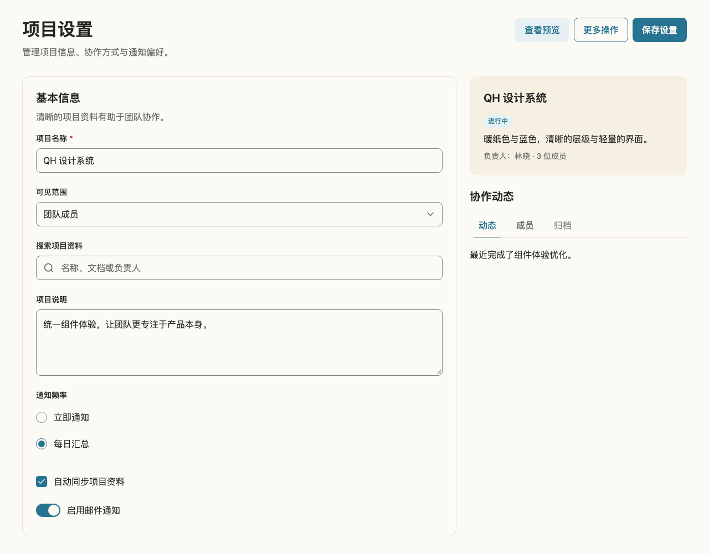

# Radix Themes 对齐审查与实施

日期：2026-11-11。基线：`bd5c2b3`，QH React/Tokens 0.8.0。

以 Radix Themes 为主要视觉参考，保留 QH 暖纸色、蓝色与既有语义 Token。参考的是视觉层级、状态一致性和组合尺度，核心组件仍由 QH npm 包交付，复杂交互继续使用当前 Radix/React Aria 原语。

## 官方参考与适配边界

- [Theme overview](https://www.radix-ui.com/themes/docs/theme/overview)：通过主题尺度与变体形成相对重要性。
- [Button](https://www.radix-ui.com/themes/docs/components/button)：solid、soft、outline、ghost 分层。QH primary 对应 solid，新增 soft/outline；secondary 保留兼容。QH ghost 保留完整触控区域，不复制其负边距布局。
- [Text Field](https://www.radix-ui.com/themes/docs/components/text-field)：图标/操作 slot 与输入框匹配尺寸。QH 继续使用 InputGroup，修正组合后的尺寸与状态一致性。
- [Tabs](https://www.radix-ui.com/themes/docs/components/tabs)：明确活动标签与内容层级。QH 保留当前下划线、键盘行为及窄容器滚动。
- [Select](https://www.radix-ui.com/themes/docs/components/select)：参考触发器对齐与状态。QH 原生 Select 保留系统选择器，复杂选项继续由现有 Combobox/MultiSelect 处理。

不采用 Radix 默认的小控件尺度、任意主题色或暗色模式。QH 默认操作高度 44px，移动输入字号 16px；控件/卡片圆角保持 8/12px，间距保持 4px 尺度。装饰线与可识别控件边界分开。

## 差距与处理

| 范围                                           | 基线发现                                                                                                  | 本轮处理                                                                                                                         |
| ---------------------------------------------- | --------------------------------------------------------------------------------------------------------- | -------------------------------------------------------------------------------------------------------------------------------- |
| Button / ButtonLink / IconButton               | primary、secondary、ghost、danger 已有；缺少蓝色低强调与描边层级，弹层打开时没有持续的操作状态            | 新增共享 soft/outline，补齐 hover、pressed/open、focus、disabled/loading 的组合；保留现有默认值                                  |
| Input / Textarea / Select                      | Select 已有 hover/active，其他输入控件缺少一致反馈；Select sm 的内边距使高度超过其尺寸 Token              | 统一表面控件状态，错误边界和焦点轮廓独立；修正 Select sm 高度                                                                    |
| InputGroup / SearchInput                       | 实测空值和输入后外框均为 46px，内部 Input 尺寸类覆盖 grouped 最小高度；浏览器原生与自定义清除按钮同时出现 | 修正 grouped 特异性并保留完整 action 点击尺寸；仅在 SearchInput 隐藏重复原生清除装饰，保留 type=search，空值/输入/清除全过程稳定 |
| Tabs                                           | 活动标签 hover 被通用文字色覆盖，缺少 pressed 状态                                                        | 保留蓝色活动标识，统一 hover/pressed 背景，不改变键盘、RTL 和滚动行为                                                            |
| Checkbox / RadioGroup / Switch                 | 已有 checked、invalid、focus、disabled，但缺少 hover/pressed 反馈；禁用选中的 radio 指示仍为强调蓝        | 补齐状态优先级与禁用指示，保持可访问名称和原生表单行为                                                                           |
| Card / Badge / Text / Heading / Table          | 已有平面容器、状态填充、UI/阅读排版、标题视觉尺寸和表格局部滚动                                           | 保留现有 API；不为视觉相似度额外增加无实际需求的变体                                                                             |
| Menu / Popover / Dialog / AlertDialog / Drawer | 已有 Paper 表面、必要阴影、焦点与浮层行为；QH 的 44px 条目是有意的移动适配                                | 保留现有交互与浮层结构，使用真实组合验证新按钮打开态                                                                             |
| 复杂选择、日期、上传与布局组件                 | React Aria 行为边界、业务无关 API 和响应式契约继续适用                                                    | 保持架构边界，通过全量 Story/浏览器回归检查共享控件改动的影响                                                                    |

颜色新增项仅为既有批准色的语义别名，不新增原始色值。soft 的 hover 使用更深的既有蓝色文字，pressed/open 使用明确的 Blue Dark/Paper 层级；outline 的背景由透明到蓝色轻填充，再到按下态。

## 落地范围与验收

项目筛选使用 soft 表达次于页面创建的操作，项目详情归档与批量操作使用 outline。独立示例和真实页面继续组合 `@qhkg/react`，不复制组件实现。新增完整控件工作台用于桌面、手机和长内容视觉验收。

每项组件变动同步实现、Story、测试、元数据和 Changeset；新增 Story 保留 `ai-generated`。验收包括 320/375/768/1280px、200% 文字缩放、RTL、触控尺寸、输入/清除稳定性、invalid/disabled、键盘与浮层焦点还原。自动 a11y 与浏览器测试不能替代完整真机读屏验收。

## 已实现的使用方式

```tsx
<Button>保存设置</Button>
<Button variant="soft">应用筛选</Button>
<Button variant="outline">导出设置</Button>
<Button variant="ghost">清除</Button>
```

ButtonLink 和 IconButton 共享相同变体，导航仍使用 ButtonLink，危险操作仍使用 danger 与 AlertDialog。Menu 等触发器的 open 状态持续保留按下反馈；禁用、加载和焦点规则独立生效。

输入控件继续只有明确的 Paper 表面，避免给每种表单引入不必要的变体。InputGroup、SearchInput、Select 的 sm/md/lg 在默认字号下分别为 36/44/48px，默认仍为 md；输入字号保持 16px。SearchInput 保留原生 search 类型与显式可访问清除按钮，避免重复的浏览器清除装饰。

验证中额外修复了 Switch 的 RTL 滑块越界：使用逻辑 inset 定位替代固定方向的 transform，实际构建产物在 LTR/RTL 下都保持滑块位于轨道内。invalid 用独立内描边表达，键盘焦点仍有外轮廓。

## 构建后实际效果

新增 Story：`Foundation/VisualLanguage`，组合真实核心组件展示项目设置、页面操作、预览与 Tabs。页面操作在手机自然换行，桌面使用双栏，表单提交、搜索清除与菜单仍可操作。



[手机组件组合](assets/radix-alignment-mobile.png)


## 升级边界

本轮新增 API 与语义 Token 通过 minor Changeset 一起交付，既有按钮默认值和 secondary 继续可用。Registry 副本需按需合并；正式发布时必须先生成包版本、同步 Registry 依赖并一起发布，不能把依赖 soft/outline 的区块单独部署到仍使用 0.8.0 核心包的环境。

本轮未引入 Radix Themes 运行时依赖。已合适的 Card、排版、表格和浮层结构继续沿用；全量回归用于检查共享样式变动是否影响现有组合。

## 验证结果

- `pnpm check` 通过：格式、lint、类型检查、137 个 React 单元测试、4 个 Token 测试、437 个 Story 的交互与自动可访问性检查，以及完整构建。
- 浏览器全量回归与最终用例复验汇总：Chromium 50 项、Firefox 49 项、WebKit 49 项通过；Firefox/WebKit 的强制颜色模拟各跳过 1 项，该场景由 Chromium 验证。
- 新增的 18 个跨浏览器用例覆盖组合尺寸、清除、表单反馈、按钮打开态、键盘焦点、选择控件状态、Tabs、RTL 和响应式工作台。焦点断言遵循浏览器的 focus-visible 行为，并等待异步焦点还原。
- E2E 文件独立类型检查、发布包内容、SSR 导入、按需加载与静态文档契约检查通过。
- 既有 Pagination 的 `end-ellipsis` 重复键控制台警告仍存在，该组件源码未在本轮修改，保留为独立缺陷。

当前状态为源码完成，包含待发布的 minor Changeset；线上与 npm 版本尚未变更。

## 计时页接入补充（2026-11-13）

移动端分组长标题复现 Button 内部 flex 内容不收缩。先增加 TruncatedLabel Story 证明失败，再为共享内容容器设置 min-inline-size: 0 与 max-inline-size: 100%，保持调用方决定换行或省略，不隐藏组件全局溢出或焦点。新增 Chromium/Firefox/WebKit 回归验证 320px 受限宽度下数量、标签与触控行为。
