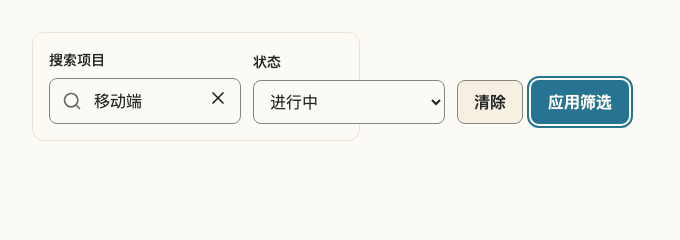
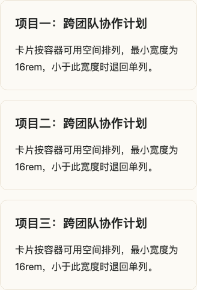

# QH 响应式 UI 升级调研与改造方案

日期：2026-11-05  
状态：架构审查、功能开发与自动化验收完成；具体交付及边界见第 8、9 节  
审计基线：本地工作区，HEAD `fbca36f`，`@qhkg/react` 0.6.0

## 1. 结论与范围

QH 已有移动端优先规范、语义 Token、布局组件、局部滚动表格、动态视口弹层，以及跨浏览器发布冒烟测试。下一阶段最值得投入的是**容器适配、任务与操作层级、长内容容错，以及能够阻止回归的验收机制**。

本次浏览器检查发现：同一组件在全宽窗口下能通过溢出检查，放进桌面端窄区域后仍会使用宽屏布局。筛选栏、工具栏和分页都有可复现的越界；Grid 虽不越界，卡片却被挤成难以阅读的窄列。这比简单增加断点更接近当前体验问题的原因。

建议继续沿用 npm 核心组件 + Registry Pattern 架构和现有行为原语，通过三个批次逐步升级。品牌、语义色、默认 44px 控件、8px 控件圆角、12px 卡片圆角和 4px 间距尺度继续作为约束。

本次完成架构和实现审查、Storybook MCP 查询、官方资料调研，以及 Chromium 定向浏览器检查。没有开展用户访谈、线上行为数据分析、全库视觉验收、真实手机键盘测试或完整 WCAG 合规审计。仓库原有 Breadcrumb Story 改动未纳入本次编辑。

## 2. 开源社区值得借鉴的原则

以下外部原则取自官方文档；“QH 落地”是本次建议，不代表社区统一标准，也不意味着引入对应库作为新依赖。

| 对标           | 官方原则                                                                                       | QH 落地                                                                                             |
| -------------- | ---------------------------------------------------------------------------------------------- | --------------------------------------------------------------------------------------------------- |
| GitHub Primer  | 响应式同时适应屏幕、交互和用户偏好；多栏任务可以分视图、调整区域位置或通过明确入口进入辅助面板 | 按“查找、筛选、查看、编辑”设计完整流程，侧栏不能只缩小或直接隐藏；主要操作保持可发现                |
| Radix Themes   | 布局职责与内容、交互分离，使用 Flex、Grid、Container 等组织空间                                | 增强已有 Stack、Inline、Grid、PageContainer，避免在每个 Button、Input 上复制响应式属性              |
| React Spectrum | 父布局负责组件间距；使用明确布局与 slot；弹层可显式指定小屏呈现方式                            | 让 Pattern 管理字段、操作和错误信息的排列；复杂任务可以明确选择 Drawer 或独立页面，并保留状态与焦点 |
| MUI            | 提供统一断点和容器查询工具，容器查询需要建立祖先容器上下文                                     | 页面结构使用 viewport；复用区块按实际容器宽度布局，避免桌面弹窗和侧栏错误启用桌面排列               |
| IBM Carbon     | 流动列宽与稳定的边距、间距尺度配合；布局在断点处变化，并验证各断点                             | 保留 QH 的 4px 尺度，定义一致的内容宽度和 gutter；按内容最低可读宽度决定列数                        |

资料：[Primer 响应式](https://primer.style/product/getting-started/foundations/responsive/)、[Primer 布局](https://primer.style/product/getting-started/foundations/layout/)、[Radix 布局](https://www.radix-ui.com/themes/docs/overview/layout)、[Spectrum 布局](https://react-spectrum.adobe.com/v3/layout.html)、[Spectrum DialogTrigger](https://react-spectrum.adobe.com/v3/DialogTrigger.html)、[MUI 断点](https://mui.com/material-ui/customization/breakpoints/)、[MUI 容器查询](https://mui.com/material-ui/customization/container-queries/)、[Carbon 2x Grid](https://www.carbondesignsystem.com/building-blocks/foundations/2x-grid/overview)。访问日期：2026-11-05。

需要区分通用标准与 QH 产品要求：WCAG 2.2 AA 的目标尺寸条款为 24×24 CSS px，并有间距等例外；QH 默认 44px 是更高的项目要求。文本放大 200% 与 Reflow 也应分别验证：Reflow 对通常纵向滚动的内容要求等效 320 CSS px 宽下不丢失信息或功能，通常无需双向滚动，必要二维内容有例外；1280px 在 400% 浏览器缩放下对应这一宽度。不能把 200% 检查当成完整 Reflow 验收。

资料：[W3C Target Size Minimum](https://www.w3.org/WAI/WCAG22/Understanding/target-size-minimum.html)、[W3C Resize Text](https://www.w3.org/WAI/WCAG22/Understanding/resize-text.html)、[W3C Reflow](https://www.w3.org/WAI/WCAG22/Understanding/reflow.html)。

## 3. 现状与可复现证据

### 已有能力应保留

- `theme.css` 已定义 16 / 24 / 32px 页面 gutter、阅读与内容最大宽度、流动标题字号和 reduced-motion。
- Grid 已提供 `base / md / lg` 列数；Inline 默认允许换行；PageContainer 管理页面宽度。
- Dialog 使用 `dvh` 和内部滚动；Drawer 已处理底部安全区；Table 有独立、可聚焦的横向滚动区域。
- E2E 已覆盖移动导航焦点恢复、日期弹层、表格选择、页面操作等 320px 路径，并在 CI 配置 Chromium、Firefox、WebKit。
- `docs/capability-roadmap.md` 已将视觉回归、完整尺寸矩阵和缩放验收列为未完成项，本方案细化这些工作。

### 本次浏览器检查方法

启动当前源码 Storybook，通过 `/mcp` 的 `docs-list`、`docs-show` 确认 Grid、Toolbar、FilterBar、Pagination、MobileBottomActionBar 的文档和真实 Story。使用 Chromium 对以下六个 Story 各检查 320、375、640、768、1024、1280px 窗口，共 36 个窗口场景：

- `patterns-toolbar--multiple-actions`
- `patterns-filterbar--default`
- `patterns-pageheader--long-content`
- `layout-grid--default`
- `navigation-pagination--long-content`
- `patterns-mobilebottomactionbar--long-content`

检查 `documentElement.scrollWidth - clientWidth`。这 36 个窗口场景未检出超过 1px 的页面横向溢出；这只说明该检查项通过，不能推出全部交互与视觉均良好。

另在 1280×800 窗口中，将 Story 的 `#storybook-root > main` 设置为 `width: 360px; padding: 16px`，模拟窄面板；五个非固定底栏 Story 再检查容器滚动宽度和控件位置。没有修改组件源码，未给容器添加裁剪，也未添加容器查询来改变现有行为。

| 组件 / Pattern            | 360px 容器实测                                                    | 用户影响                               | 判断                                               |
| ------------------------- | ----------------------------------------------------------------- | -------------------------------------- | -------------------------------------------------- |
| FilterBar                 | 容器 `scrollWidth` 为 613px；状态选择、清除和应用按钮越出容器右侧 | 放进侧栏、弹窗或分栏区域会破坏相邻内容 | 已复现的实现缺口                                   |
| Toolbar / MultipleActions | 容器 `scrollWidth` 为 373px；导出和新建操作越界                   | 工具操作挤出其所属区域                 | 已复现的实现缺口                                   |
| Pagination / LongContent  | 容器 `scrollWidth` 为 394px；下一页越界                           | 窄面板仍显示宽屏页码排列               | 已复现的实现缺口                                   |
| Grid / Default            | 没有横向越界，但仍为三列；截图中的标题与摘要明显碎行              | 容器很窄时卡片可读性下降               | 已观察到的视觉问题；需区分显式固定列数与自适应模式 |
| PageHeader / LongContent  | 本场景没有越界                                                    | 当前样例具有一定容错能力               | 不能据此认定其他操作数量和语言均通过               |

这些窄容器场景的页面横向溢出仍为 0，因此现有整页溢出断言无法捕获它们。测试需要同时检查宿主容器和子控件边界。

FilterBar 当前表现：窄边框属于筛选栏，右侧控件已伸出边框。

Grid 当前表现：容器不溢出，但在 360px 区域中沿用三列，内容被挤压。

### 静态审查发现的其他风险

| 风险                         | 代码证据                                                                                                                     | 当前结论与待验证内容                                                                  |
| ---------------------------- | ---------------------------------------------------------------------------------------------------------------------------- | ------------------------------------------------------------------------------------- |
| 组件主要依赖窗口断点         | `Grid.module.css` 使用 768 / 1024px；`filter-bar.tsx`、`toolbar.tsx` 使用 `md:grid-cols-*`；Pagination 使用 `40rem` 媒体查询 | 根因与上述窄容器复现吻合，应该优先修复                                                |
| 固定底栏占位依赖使用方       | `MobileBottomActionBar.stories.tsx` 用 `pb-32` 预留空间；实现为 `fixed`，摘要长度可变                                        | 静态占位无法保证匹配所有语言、字号和安全区，需要可变高度契约和末尾内容测试            |
| 单个主操作仍占双列中的一列   | `mobile-bottom-action-bar.tsx` 在无次操作时输出空 `span`，操作区仍为两列                                                     | 主操作利用空间不足；需补单操作 Story 后改进排列                                       |
| Tabs 的滚动提示弱            | `Tabs.module.css` 开启横向滚动，同时隐藏滚动条                                                                               | 尚未证明键盘失败；应检查用户是否能发现后续标签、焦点和选中项是否始终可见              |
| 弹层高度适配不等于键盘可用   | Dialog 使用 `85dvh`、整体内容滚动；Drawer 有底部安全区和 sticky footer                                                       | 没有真实手机键盘证据，不判定已失败；需补横屏短高度、放大和 iOS / Android 键盘任务验收 |
| 视觉和尺寸验收未形成完整门槛 | E2E 以 320px 发布路径为主；截图配置为失败时截图，CI 中未见受审截图基线比较                                                   | Story 的 Mobile 示例和跨浏览器配置已有价值，但不能替代完整视觉回归、窄容器和缩放验证  |

## 4. 建议建立的响应式契约

### 4.1 页面与容器分工

页面级响应式管理主导航、侧栏、阅读区域和辅助区域；组件容器级响应式管理字段、卡片、工具操作和分页。屏幕很宽不代表每个内容区都很宽。

- 保持现有 768 / 1024px 公开布局含义，先修复可复现问题，避免统一改断点引入大范围布局变化。
- 整理现有 480px、40rem、768px、1024px 等阈值，记录其内容依据。需要时保留组件专属阈值，不强行将所有行为塞进同一断点。
- Registry 工具栏、筛选栏和分页组合优先采用命名容器查询或内容自然换行；容器宽度足够时才并列展开。
- 容器上下文放在合适的宿主上，查询作用于其后代；Portal 弹层按其实际视口与定位边界适配，不能假定继承触发器容器。
- 样式优先于 JS 测量。仅当交互结构必须改变时引入状态逻辑，并验证 SSR、焦点和打开期间 resize 行为。
- 断点若建立单一事实源，应生成或校验 CSS / TS / Tailwind 对应值；不能直接假定 `@media (min-width: var(--...))` 可用。

### 4.2 以内容决定排布

- Grid 保留现有显式列数模式；为卡片场景设计独立的内容驱动模式，以经过验证的最小卡片宽度决定列数。新 API 名称、模式互斥和默认值在实施时评审，本报告不将草案属性当成可用 API。
- 最小宽度约束应能在小于单卡最小宽度时退回一列，不把横向溢出作为降级方案。
- Stack、Inline 如确有多个真实需求，再增加方向、对齐或间距的有限响应式能力；普通控件不普遍支持响应式对象属性。
- 长标题、URL、文件名、连续英文、错误说明和 loading 文案各自定义换行策略。操作文字避免无声截断，重要信息不只放 Tooltip。
- 大字号、长语言和键盘阅读顺序优先；视觉重排不得让 DOM、焦点顺序和屏幕阅读器顺序冲突。

### 4.3 操作与信息层级

- PageHeader 保留明确主操作，次操作允许换行；低频操作进入已有 Menu 时，入口必须常驻并有清晰名称。
- 搜索、常用筛选与当前筛选摘要优先可见；复杂筛选可进入有标签的 Drawer，保留已选条件、结果数量、清除和应用入口。
- 小屏列表先展示名称、状态和下一步操作；需要横向比较的数据继续使用 Table 局部滚动。摘要卡片模式只在任务需要时由 Pattern 提供，保留完整字段查看和批量选择能力。
- 表格不自动转换为卡片，不通过删除列来制造“适配完成”的假象。
- 用户在不同宽度间切换时，搜索、筛选、分页和编辑内容应保持。因空间变化关闭或迁移 Overlay 时，应明确焦点去向。

### 4.4 弹层与固定区域

- 普通 Dialog、危险确认 AlertDialog、辅助 Drawer 继续按语义选择。沿用现有 API 规则，不自动将全部 Dialog 变成 Drawer。
- 复杂表单先验证标题、正文滚动和操作区在短高度下的可访问性；只有必要时采用分区滚动，避免多个嵌套滚动区。
- MobileBottomActionBar 优先评估正常文档流中的 sticky；如必须 fixed，建立与实际高度联动的占位及安全区契约，不能依赖每个页面手写固定 `pb-*`。
- 单主操作占满可用操作区；双操作保留明确主次层级。长摘要、换行按钮、200% 文本、安全区下都不能遮挡最后一个字段或错误信息。

## 5. 实施批次与交付标准

| 批次                  | 范围                                                            | 具体交付                                                                                        | 完成判断                                                                 |
| --------------------- | --------------------------------------------------------------- | ----------------------------------------------------------------------------------------------- | ------------------------------------------------------------------------ |
| A：优先修复已复现问题 | FilterBar、Toolbar、Pagination；Grid 方案与测试基线             | 窄容器布局、有限换行和紧凑排列；为 Grid 明确显式列数和内容驱动的区别；在相关 Story 增加边界测量 | 360px 容器下操作不越界；Grid 的自适应示例能阅读；不改变既有显式列数契约  |
| B：完成移动任务闭环   | MobileBottomActionBar、Dialog / Drawer、Tabs、Header / SideNav  | 可变高度占位、单操作状态、弹层长表单与短屏、可发现的标签导航、清晰的筛选与导航返回路径          | 真实手机可完成输入、修错、提交和返回；焦点恢复、状态保留、末尾内容均通过 |
| C：形成稳定发布能力   | 列表 / 详情 / 搜索页面 Pattern、Storybook、CI、元数据与使用文档 | 审核后的截图基线、尺寸与语言场景、人工验收记录、AI 响应式契约                                   | 每项改造具备可重复检查与迁移说明，回归能阻断发布                         |

第一批建议先交付 FilterBar + Toolbar + Pagination，覆盖明确失败且改造边界较小的区域；随后实现 Grid 内容驱动模式和底部操作区契约。每批完成后复核真实列表页、设置页和详情页，避免只让孤立示例变好看。

核心组件每项提交必须包含实现、Story、测试、元数据和 Changeset；Registry Pattern 提交实现、交互 Story、Registry 元数据与关键 E2E。新增 AI Story 带 `ai-generated` 标签，截图基线由人工确认。

新能力与既有属性并存；修复应按是否改变公开契约决定 patch / minor / major。尤其 Grid 响应式默认、底栏定位默认和 Overlay 行为变化应附前后示例与迁移说明。发布前同步生成 Registry / AI 索引，避免文档比 npm 版本超前。

## 6. 验收矩阵

| 维度         | 建议场景                                                                              | 必须验证                                                     |
| ------------ | ------------------------------------------------------------------------------------- | ------------------------------------------------------------ |
| 整页宽度     | 320、375、768、1280px；本次发现涉及的 640、1024px                                     | 无非预期页面横滚，主操作可达、布局顺序清楚                   |
| 断点两侧     | 对实际使用阈值检查前后 1px，例如 767 / 768、1023 / 1024                               | 无瞬间越界、重要操作丢失、重复控件和焦点丢失                 |
| 嵌入容器     | 1280px 窗口中的 280、360、480px 宿主；放进实际弹窗与侧栏复核                          | 控件不越出宿主；允许滚动的区域单独声明与检测                 |
| 高度与滚动   | 短横屏、320×256 CSS px 等效视口、长表单、页尾错误                                     | 固定区域不盖住字段、错误、焦点与操作；滚动区域可操作         |
| 字号与缩放   | 200% 文本放大；200% 浏览器缩放；400% 的等效 Reflow 场景                               | 不丢信息与功能；自动视口模拟与真实浏览器缩放分别记录         |
| 内容与语言   | 长中文、英文扩展、长 URL、单按钮 / 多按钮、RTL（适用时）                              | 合理断行、按钮文字完整、DOM 和焦点顺序可靠                   |
| 状态与输入   | default、hover、pressed / open、focus-visible、disabled、invalid、loading；键盘与触屏 | 44px 默认目标、16px 移动输入字号、状态清晰、操作不依赖 hover |
| 浏览器与设备 | Chromium / Firefox / WebKit 自动化；iOS Safari 与 Android Chrome 真机                 | 键盘弹出后当前字段和提交入口可达；焦点还原与滚动锁正确       |

自动化应分层：核心组件验证语义与状态；Story 验证容器和长内容；页面 E2E 验证完整任务；选取稳定场景建立截图比较。不要对所有 Story 盲目做全组合笛卡尔积；第一批优先阻断已复现的越界和主操作遮挡。

溢出检查要分别检查页面、宿主、目标控件和允许局部滚动区域。截图不能替代键盘操作；a11y 自动检查不能替代读屏与手机键盘验收；通过 `deviceScaleFactor` 或页面 CSS `zoom` 也不能宣称验证了所有真实浏览器缩放行为。

## 7. 实施后的评估方式

工程验收先要求：上述确定失败的容器用例归零，关键操作无裁剪和遮挡，相关 Story、键盘、a11y、SSR 与跨浏览器检查通过，截图变更已经审核。

用户体验改善应通过相同任务的前后对照确认：移动端查找并打开项目、组合筛选并清除、修改设置并处理错误、返回列表保留状态。观察任务完成率、误触、寻找操作的时间和主观理解难度。本次没有这些任务的用户基线，因此不承诺没有数据支持的提升百分比。

相关规范：[总体架构](adr/0001-component-library-architecture.md)、[组件 API](component-api-guidelines.md)、[既有开源审计](open-source-benchmarks.md)、[能力路线图](capability-roadmap.md)。

## 8. 架构审查后的实施决策

审查日期：2026-11-05。用户授权审查后直接实施。上文第 3 节保留改造前的审计证据；下表记录实际收敛后的技术方案。

| 审查问题                                            | 最终决策                                                             | 实施结果                                                                                                      |
| --------------------------------------------------- | -------------------------------------------------------------------- | ------------------------------------------------------------------------------------------------------------- |
| 全面添加容器查询会增加宿主约束与维护成本            | 自然换行足够的 Pattern 优先采用 Flex；仅在真实行为切换处使用容器查询 | FilterBar、Toolbar、PageHeader 按内容换行；Header 使用自身 48rem 容器阈值；Pagination 使用自身 40rem 容器阈值 |
| 将现有 Grid 默认改为自动列数会改变使用方布局        | 保留数字列数和视口响应式对象，新增显式 opt-in                        | `columns="auto"` 配合 `minItemWidth="sm\|md\|lg"`；默认 16rem，类型排除固定列数与最小卡宽混用                 |
| 把 fixed 改成 sticky 会改变操作栏出现时机和宿主要求 | 保留固定移动操作区与 768px 起内联的契约，组件自行提供占位            | ResizeObserver 测量实际高度，等高 spacer 参与主文档流；单操作占满一行；超长区域最多占 50dvh 并可滚动          |
| 仅通过高度限制无法确保长表单任务完成                | 保留 Dialog / Drawer 语义，验证真实输入、修错、保存与焦点恢复        | 弹层考虑安全区和动态高度，长内容不压缩，按钮视觉与 DOM 顺序一致；新增长表单 Story 和短视口 E2E                |
| 收窄时隐藏当前焦点控件会丢失键盘位置                | 明确可见焦点回退，而非整体重建 UI                                    | Pagination 收窄时转移到可用前后页控件；Header 在移动导航关闭时可回退到首页链接                                |
| 标签可滚动却缺乏提示或受控切换后不可见              | 保留系统滚动提示，并仅滚动标签列表                                   | Tabs 监听焦点、选中状态与容器变化；LTR / RTL 下使当前标签可见，不滚动整页                                     |
| Story play 与 E2E 同时执行使测试不确定              | 两层测试分别拥有交互驱动权                                           | E2E 使用 Storybook 的 `embed=true` 禁止自动 play；MCP 单独执行 Story 交互与 a11y                              |
| Tailwind 隐藏工具类会被无层组件 display 覆盖        | 在当前架构内对布局隐藏使用明确优先级，不全库更换层叠方案             | Header 的菜单触发器使用 `hidden!` 容器变体；未用 important 改写组件颜色、间距或焦点                           |

### 接入与兼容

- 不新增依赖、行为原语、路由或数据层；Registry 仍只组合核心组件。
- Grid 的既有数字列数与 `{ base, md, lg }` 行为保持；自动模式不依赖 DOM 测量，无额外 SSR 分支。
- Pagination 不重建受控页码状态；Tabs 不改变激活方式和键盘模型；Dialog 不会自动变成 Drawer。
- 使用方更新 MobileBottomActionBar 副本后应删除旧的 `pb-32` 等手写补偿，将操作栏放在主文档流内容末尾。测量发生在客户端，SSR 使用一致结构与保守初始占位。带 transform 或独立滚动的祖先不属于该固定定位 Pattern 的接入范围。
- MobileNav 新增可选的 `fallbackFocusRef`，仅在触发器被布局隐藏时使用。Header 自动接到自己的首页链接。
- 窄屏 Dialog / Drawer 操作顺序从原有视觉倒序改为与 DOM 一致；更新页面时需要复核按钮顺序。
- Changeset 记录核心组件的 minor 变更和 Registry 迁移说明；发布仍由正常发布流程执行。

### 自动化与视觉交付

新增 `e2e/responsive.spec.ts`，纳入现有三浏览器 CI，覆盖：280 / 360 / 480px 桌面窄面板、主要断点两侧、列表 / 详情 / 搜索页面、Grid 自动与显式模式、分页状态与焦点、动态底栏、LTR / RTL 标签、短屏长表单和 200% 根字号场景。200% 根字号检查不等于真实浏览器缩放或手机键盘验收。

发布 E2E 先构建 Storybook，再通过 Vite preview 检查静态产物，避免开发服务冷编译影响就绪判断。开发和 MCP 继续使用开发服务，交互测试与产物验收各自独立。

360px 窄面板截图进入 Playwright 报告；CI 成功和失败时均保留报告，供视觉检查。改造后的 FilterBar 与 Grid 自动模式截图见下方。像素比较所需的受审跨平台基线、真实 iOS / Android 键盘和人工读屏检查仍需在真实环境执行，未标记为已通过；它们不能通过更新快照或浏览器模拟假装完成。

## 9. 最终验收记录

2026-11-05，当前工作区结果：

- 413 个 Story 的交互与自动 a11y 检查通过，由 Storybook MCP 全量执行。
- Chromium、Firefox、WebKit 共 111 项发布与响应式 E2E 通过，检查构建后的静态 Storybook。
- React 包 57 个测试文件、126 项单元测试通过；Token 与接入 CLI 的测试通过。
- 全仓格式、lint、TypeScript 检查、完整构建通过。
- 发布契约检查通过：14 个 Registry item、57 个按需组件入口、SSR import 与静态文档。
- 改造前后截图已检查；元数据、Registry、AI 索引、项目 Skill 引用和 Changeset 已同步。

功能与自动化交付完成。真实设备键盘、浏览器实际缩放、人工读屏和受审跨平台像素基线仍列在路线图的人工验收项中，未将它们计入上述通过数量。本次没有执行 npm 发布或线上部署。
