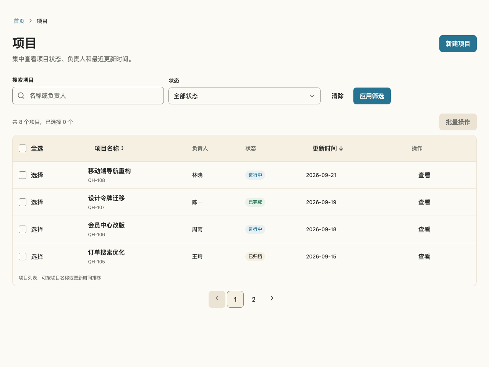
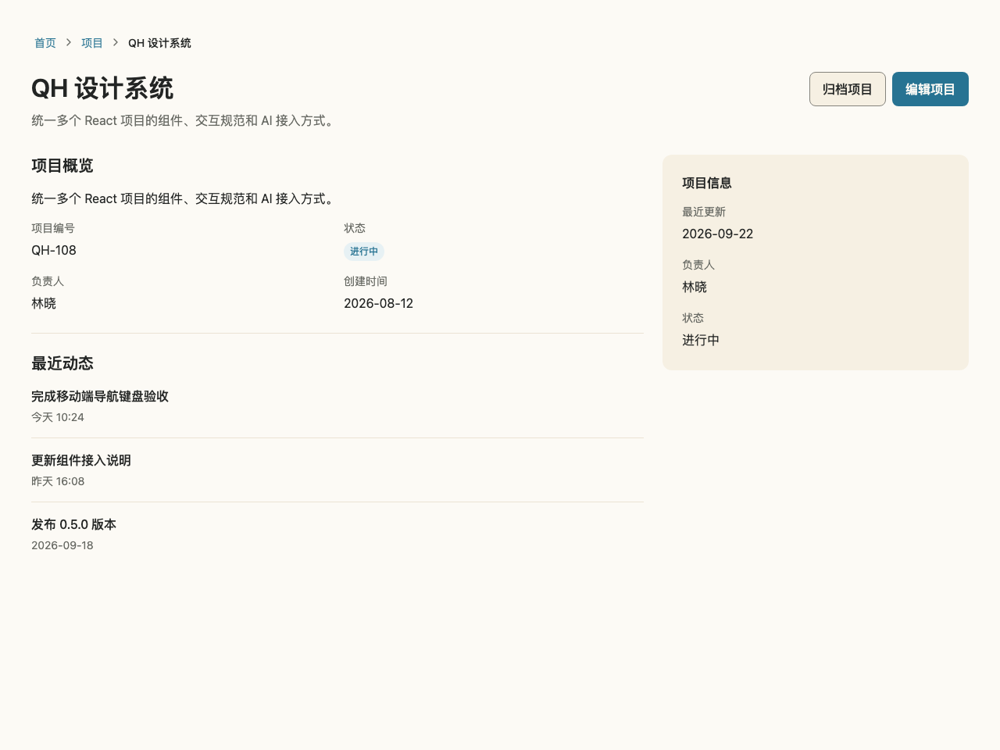
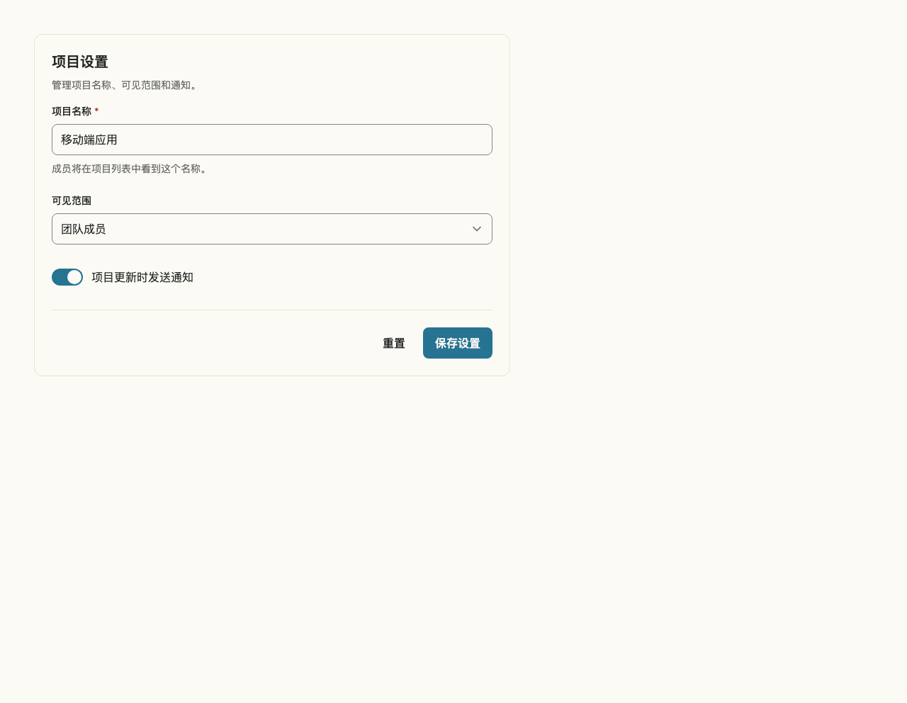

# QH 工具界面的现代扁平化规则

日期：2026-11-06。实现状态：源码已完成，随本次 minor 版本交付；版本记录见包 CHANGELOG。

设计依据与前后草案见[视觉审查](flat-visual-style-review.md)。保留 Paper、Warm 与 QH Blue 品牌；主要操作继续使用 Blue Dark 与 Paper。本文规定组合方式，API 以对应 TypeScript 和 Story 为准。

## 排版与页面

- 工具页面使用语义 h1 与 `Heading size="lg"`，在默认字号下手机约 24px、桌面最高 32px。展示型页面可继续使用 xl，Heading 全局默认值保持不变。
- `Text` 默认 `variant="body"`，保留 1.75 阅读行高。页面说明、结果统计、短状态文案显式使用 `variant="ui"`，行高为 1.5；不要用 className 覆盖内部字号和行高。
- 页面由一个 PageContainer 管理 gutter。完整页面 Story 设置 `layout: "fullscreen"` 与 `qh: { page: true }`；独立组件 Story 保留展示留白。
- 单列表页面可以视觉隐藏重复分区标题，继续通过 aria-labelledby 提供区域名称；多分区内容保留可见标题。

## 区块与操作

- FilterBar 和 Toolbar 默认 `variant="outlined"`，供独立区块使用；嵌入完整页面时使用 `variant="plain"`，通过间距组织，不再增加一层外框。
- 项目列表保留表格边界与行分隔。详情主内容使用语义 section、标题与必要分隔线；辅助信息可以放入 Warm 填充卡片。普通内容区不使用 elevation 强调，真正浮层保留阴影。
- 每个任务区域用 primary 突出主要操作，secondary 表达次要操作，ghost 用于清除、重置、查看等辅助动作。ghost 在 hover/pressed 时改变轻量背景，保留透明边框；focus-visible 始终有独立轮廓。
- 交互背景使用 `--qh-color-surface-hover`、`--qh-color-surface-pressed`；控件 hover 边界使用 `--qh-color-border-control-hover`。这些别名复用已批准颜色，不增加原始色值。

## 下拉选择与移动端

- Select 保留原生 select，Lucide SVG 仅替代外观箭头；默认在逻辑末端内缩 12px，lg 内缩 16px，图标不接收点击或焦点。强制颜色模式恢复原生箭头，multiple 模式不显示下拉箭头。
- Select 的 className/style 作用于外层布局容器；id、name、事件和 ref 仍作用于原生 select。依赖旧 DOM 直接子元素选择器的应用应改用组件 API 或布局容器。
- 保留 4px 间距尺度、8px 控件圆角、12px 卡片圆角、44px 默认控件高度与手机 16px 输入字号。
- 必要操作在触屏中可发现；表格只在局部横向滚动。窄容器和文字放大场景按内容自然换行。

## 迁移与验证

Text 新 API 和新增状态 Token 需要下一次 minor 版本。已有 Registry 副本不会自动更新；升级核心包和 Tokens 后，按需合并页面区块改动。发布流程先生成包版本并同步 Registry 依赖范围，再发布对应包与公开 Registry，不单独将依赖新 API 的区块部署给旧版核心包。

已有正文默认排版、Card 变体和交互原语保持兼容。未引入新的全局 CSS cascade layer；核心样式与 Tailwind 的级联规则仍按 ADR 执行，布局工具与核心属性冲突的进一步调整需单独设计和验证。

验收覆盖组件/Story/a11y、三个浏览器、320/375/768/1280px、200% 文字缩放、长内容、原生表单提交/重置、状态与键盘焦点。系统原生选项弹窗的完整按键流程及实际触屏体验需真机验收，不能由无头浏览器测试替代。

## 实际实现效果

以下截图来自构建后的本地页面，使用真实组件实现；与审查中的临时 CSS 草案区分。

| 视口   | 标题字号 | 页面左侧 gutter | Select 高度 / 字号 | SVG 箭头内缩 | 页面宽度 |
| ------ | -------- | --------------- | ------------------ | ------------ | -------- |
| 1280px | 32px     | 32px            | 44px / 16px        | 12px         | 1280px   |
| 375px  | 24px     | 16px            | 44px / 16px        | 12px         | 375px    |

项目列表：

[手机项目列表](assets/flat-style-implemented-mobile.png)

项目详情：

[手机项目详情](assets/flat-detail-implemented-mobile.png)

设置表单：

[手机设置表单](assets/flat-settings-implemented-mobile.png)

## 本次验证结果

- 131 个 React 单元测试、3 个 Token 测试通过。
- 423 个 Story 的交互与自动可访问性检查通过；搜索页最后的标签布局调整另行复验通过。
- Chromium、Firefox、WebKit 共 130 个浏览器用例通过。另有 2 项强制颜色模拟用例按浏览器能力跳过，该场景在 Chromium 验证。
- 格式、lint、项目类型检查、E2E 文件类型检查、完整构建、发布包契约、SSR 导入与按需加载校验通过。
- 全量 Story 日志仍有 Pagination 的 `end-ellipsis` 重复键警告；该组件源码未在本次修改，此项保留为独立缺陷。

功能已完成源码实现；发布版本与时间以 [React 变更记录](../packages/react/CHANGELOG.md)、[Tokens 变更记录](../packages/tokens/CHANGELOG.md) 和对应 GitHub Release 为准。
